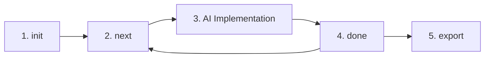

# build-with-ai

<div align="center">

<pre>
  ____  _   _ ___ _     ____      __        _____ _____ _   _          _    ___ 
 | __ )| | | |_ _| |   |  _ \     \ \      / /_ _|_   _| | | |        / \  |_ _|
 |  _ \| | | || || |   | | | |     \ \ /\ / / | |  | | | |_| |       / _ \  | | 
 | |_) | |_| || || |___| |_| |      \ V  V /  | |  | | |  _  |      / ___ \ | | 
 |____/ \___/|___|_____|____/        \_/\_/  |___| |_| |_| |_|     /_/   \_\___|
</pre>

**Deterministic, context-aware prompt engine for building complete software projects with any AI.**

[](https://www.npmjs.com/package/build-with-ai)
[](https://www.npmjs.com/package/build-with-ai)
[](https://github.com/PicadoLabs/build-with-ai/actions/workflows/ci.yml)
[](LICENSE)
[](https://nodejs.org)
[-8b5cf6.svg?style=flat-square)](README.md)
[](CONTRIBUTING.md)

```bash
npx build-with-ai
```

[Quickstart](#quickstart) &bull; [Workflow](#the-4-step-workflow) &bull; [Templates](#available-templates) &bull; [CLI Reference](#cli-reference) &bull; [Autonomous Mode](#byok-autonomous-mode) &bull; [MCP Server](#model-context-protocol-mcp) &bull; [Contributing](CONTRIBUTING.md)

</div>

---

## Why build-with-ai?

Prompting an AI model to "build an entire app" typically breaks down in three ways:

1. **The Blank Canvas Problem**: Monolithic prompts produce hallucinated schemas and unmaintainable code dumps.
2. **Context Drift**: In long conversations, AI forgets early database designs, auth models, and naming standards.
3. **Skipped Foundations**: Models jump to frontend polish before data models, contracts, and error handling exist.

`build-with-ai` solves this by breaking application development into structured, sequential engineering phases. It records decisions in a local `context.json` file and automatically injects them into downstream prompts (`{{decisions.key}}`).

### Key Principles

- **Zero API Keys & Zero Cost**: Runs 100% locally in your terminal. Works out of the box with web UIs (ChatGPT, Claude), IDEs (Cursor, Windsurf), or local LLMs (Ollama).
- **Universal Compatibility**: Generates tailored prompts for any AI model without vendor lock-in.
- **Non-Destructive**: State is maintained exclusively inside `.buildwithai/` and never alters your application code unexpectedly.
- **AI Editor Ready**: Ships with a native Model Context Protocol (MCP) server and automatic editor rules synchronization (`.cursorrules`, `CLAUDE.md`, etc.).

---

## Quickstart

Run directly without prior installation:

```bash
npx build-with-ai
```

Or install globally:

```bash
npm install -g build-with-ai
```

Initialize your workspace:

```bash
npx build-with-ai init
```

---

## The 4-Step Workflow



### 1. Initialize (`init`)
Select a technology template, your experience level, and a project summary:
```bash
npx build-with-ai init
```

### 2. Generate Prompt (`next`)
Formats the active phase requirements, identifies target files, and copies the context-injected prompt to your clipboard:
```bash
npx build-with-ai next
```

### 3. Record Decisions (`done`)
Paste the prompt into your AI tool, review the generated code, and record architectural decisions:
```bash
npx build-with-ai done
```
You can also parse decisions directly from the clipboard:
```bash
npx build-with-ai done --from-clipboard
```

### 4. Export & Sync Rules (`export`)
Export clean Markdown documentation and sync your project decisions across editor rule files:
```bash
npx build-with-ai export
npx build-with-ai export --rules
```

---

## Available Templates

`build-with-ai` ships with 11 production-ready workflow templates:

| Template ID | Name | Steps | Core Stack |
| :--- | :--- | :---: | :--- |
| `web-app` | Full-Stack Web Application | 23 | Next.js / React, Tailwind CSS, Prisma, PostgreSQL |
| `saas-mvp` | Modern SaaS MVP | 15 | Next.js App Router, Supabase, Stripe, Resend |
| `rest-api` | Backend REST API Service | 10 | Node.js, Fastify / Express, PostgreSQL, Zod |
| `fastapi-backend` | Python FastAPI Microservices | 12 | Python 3.11+, FastAPI, Pydantic v2, SQLAlchemy 2.0, Alembic |
| `mobile-app` | Cross-Platform Mobile App | 15 | React Native, Expo Router, NativeWind, EAS Build |
| `flutter-app` | Flutter Mobile Application | 16 | Flutter 3.x, Dart, Riverpod / BLoC, Clean Architecture |
| `electron-app` | Electron Desktop Application | 12 | Electron, Vite, React, IPC Handlers, electron-builder |
| `chrome-extension` | Chrome Browser Extension | 12 | Manifest V3, Vite, React, Shadow DOM |
| `ai-agent` | AI Agent & RAG Pipeline | 14 | LangChain / LlamaIndex, Vector DB, FastAPI / Express |
| `ai-orchestration` | Multi-Agent Orchestration | 14 | LangGraph / CrewAI, AutoGen, Vector DB, Telemetry |
| `discord-bot` | Discord Bot Workflow | 12 | Node.js, discord.js v14, Slash Commands, SQLite / PostgreSQL |

### Custom and Remote Templates

Load team-specific or custom templates from a local file or HTTPS URL:

```bash
# Local JSON template
npx build-with-ai init --template ./custom-template.json

# Remote HTTPS template
npx build-with-ai init --template https://raw.githubusercontent.com/org/repo/main/template.json

# Discover community templates
npx build-with-ai search saas
```

Custom templates are persisted to `.buildwithai/template.json` and work fully offline for all subsequent commands.

---

## CLI Reference

### Core Workflow

| Command | Description |
| :--- | :--- |
| `npx build-with-ai` | Interactive launcher. Shows progress or initiates setup wizard. |
| `npx build-with-ai init` | Start interactive setup (template, experience, overview). |
| `npx build-with-ai next` | Generate and copy the current step prompt to the clipboard. |
| `npx build-with-ai next --run` | BYOK autonomous mode: send prompt directly to AI provider. |
| `npx build-with-ai done` | Record step decisions, archive step logs, and advance to next step. |
| `npx build-with-ai undo` | Roll back most recent step, restore context snapshot, and prune history. |
| `npx build-with-ai back` | Step back to previous step without removing recorded context. |
| `npx build-with-ai jump [step]` | Navigate directly to a specific step number. |

### Context & Configuration

| Command | Description |
| :--- | :--- |
| `npx build-with-ai status` | Display progress bar, completed steps, and active decisions. |
| `npx build-with-ai context [key]` | Inspect recorded decisions or retrieve a specific dot-notation path. |
| `npx build-with-ai set <key> <value>` | Update a decision in `context.json` directly from the CLI. |
| `npx build-with-ai config` | Interactive key-picker to browse and edit decisions. |
| `npx build-with-ai history [step]` | Inspect archived AI responses and step logs. |
| `npx build-with-ai resume` | Summary dashboard displaying active state and recommended next action. |

### Documentation & Editor Rules

| Command | Description |
| :--- | :--- |
| `npx build-with-ai export` | Generate `README.md`, `BUILD_LOG.md`, and `.buildwithai/CONTEXT.md`. |
| `npx build-with-ai export --rules` | Sync decisions to `.cursorrules`, `CLAUDE.md`, `.windsurfrules`, and Copilot. |
| `npx build-with-ai export --force` | Overwrite existing `README.md` without confirmation. |
| `npx build-with-ai reset` | Clean `.buildwithai/` state while preserving project source code. |
| `npx build-with-ai mcp` | Launch Model Context Protocol (MCP) stdio server. |

---

## Advanced Capabilities

### BYOK Autonomous Mode

Bring Your Own Key or use local Ollama to bypass copy-pasting. The CLI executes the step prompt, writes returned code files into your workspace, updates `context.json`, and advances the phase:

```bash
export OPENAI_API_KEY=sk-...
npx build-with-ai next --run

# Preview git-style diffs before files are written
npx build-with-ai next --run --review

# Use a local model with Ollama (no API key required)
npx build-with-ai next --run --provider ollama
```

Supported providers: `openai`, `anthropic`, `gemini`, `deepseek`, `groq`, `together`, `ollama`.

### Model Context Protocol (MCP)

Start a native stdio MCP server to let AI coding tools drive the workflow:

```bash
npx build-with-ai mcp
```

Add to your editor configuration (`.cursor/mcp.json` or `claude_desktop_config.json`):

```json
{
  "mcpServers": {
    "build-with-ai": {
      "command": "npx",
      "args": ["build-with-ai", "mcp"],
      "cwd": "/path/to/your/project"
    }
  }
}
```

Exposed tools: `get_workflow_status`, `get_active_prompt`, `complete_step`, and `get_context`. Steps completed via MCP automatically create safe rollback snapshots.

### Editor Rules Synchronization

Keep your AI coding assistant anchored to the project's architectural decisions:

```bash
npx build-with-ai export --rules
```

Updates:
- `.cursorrules` and `.cursor/rules/project-decisions.mdc`
- `.windsurfrules`
- `CLAUDE.md`
- `.github/copilot-instructions.md`

All user instructions outside the managed `<!-- BUILD-WITH-AI:START -->` block are preserved.

Optionally, configure exported decisions in `.buildwithai/rules.config.json`:

```json
{
  "includeKeys": ["decisions.database", "decisions.auth"],
  "excludeKeys": ["decisions.scratchNotes"]
}
```

Both keys are optional; `includeKeys` selects decisions, `excludeKeys` removes them, and exclusions take precedence. Without this file, all decisions are exported.

### Branch-Scoped Storage

To isolate state across git branches, enable branch scoping:

```bash
export BUILD_WITH_AI_BRANCH_SCOPED=1
```

State is isolated under `.buildwithai/branches/<branch-name>/`, ensuring feature branches do not collide.

---

## Storage Architecture

All state is self-contained inside your project's `.buildwithai/` directory:

```text
my-project/
├── .buildwithai/
│   ├── state.json        # Progress tracking and current step pointer
│   ├── context.json      # Structured architectural decisions (single source of truth)
│   ├── template.json     # Persisted template (for offline execution)
│   ├── snapshots/        # Step snapshots for non-destructive undo/rollback
│   ├── CONTEXT.md        # Formatted markdown view of decisions
│   └── history/          # Historical step responses (step-01.md, step-02.md, ...)
├── src/                  # User application code (never touched by CLI)
├── README.md             # Generated on export
└── BUILD_LOG.md          # Generated on export
```

---

## Contributing

Contributions are welcome. Please read [CONTRIBUTING.md](CONTRIBUTING.md) for details on development setup, template specifications, and pull request guidelines.

Please review our [Code of Conduct](CODE_OF_CONDUCT.md).

---

## Security

To report security vulnerabilities, consult our [Security Policy](SECURITY.md) or contact [picadolabs@gmail.com](mailto:picadolabs@gmail.com).

---

## Maintainer

- **Maintainer:** [Vardhman Gupta](https://github.com/Kaap10)
- **Organization:** [PicadoLabs](https://github.com/PicadoLabs)
- **Contact:** [picadolabs@gmail.com](mailto:picadolabs@gmail.com)

---

## License

Licensed under the [Apache License 2.0](LICENSE).

Copyright &copy; 2026 [PicadoLabs](https://picadolabs.me).
